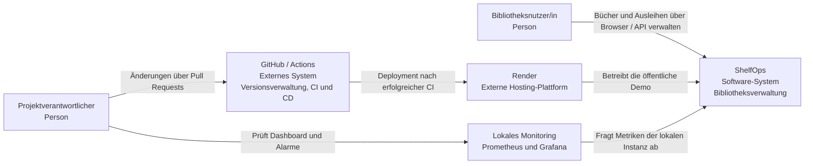
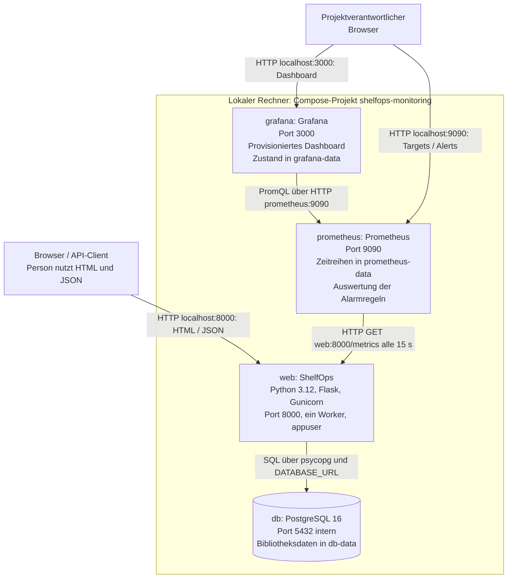

# Architektur von ShelfOps

Stand: 13.10.2026. Diese Übersicht beschreibt die versionierte Implementierung,
nicht einen dauerhaft laufenden lokalen Stack. Startanleitungen stehen im
[README](../README.md), Betriebsabläufe in [DEPLOYMENT.md](../DEPLOYMENT.md)
und Metriken, SLOs und Sicherheits-Gate in [MONITORING.md](../MONITORING.md).

## C4 – Ebene 1: Systemkontext

ShelfOps verwaltet Bücher, physische Exemplare, Mitglieder und Ausleihen.
Eine Person bedient das System im Browser oder über die JSON-API. Der
Projektverantwortliche entwickelt und betreibt die Anwendung über GitHub
und Render und beurteilt den lokalen Betrieb über das Monitoring.

Die öffentliche Demo und die lokal überwachte Instanz sind verschiedene
Instanzen desselben Systems. Das lokale Prometheus überwacht gemäss
Konfiguration den Compose-Dienst `web:8000`, nicht die Render-Instanz.
Es gibt keine Anmeldung oder Rollenprüfung; die Demo ist für erfundene
Testdaten vorgesehen, nicht für echte Mitgliederdaten.

## C4 – Ebene 2: Container des lokalen Observability-Stacks

Ein C4-Container ist ein ausführbarer Baustein oder Datenspeicher. In dieser
Ansicht entsprechen die vier Bausteine den vier Compose-Diensten aus
[docker-compose.observability.yml](../docker-compose.observability.yml).
Die Oberfläche wird von Flask ausgeliefert; es gibt keinen separaten
Frontend-Dienst.

Die veröffentlichten Ports dieses Stacks sind an `127.0.0.1` gebunden.
PostgreSQL veröffentlicht keinen Host-Port. Compose liest die lokale `.env`;
echte Passwörter gehören nicht in Git. Grafana verlangt eine Anmeldung.
Prometheus wertet Regeln aus, aber ein Alertmanager und Benachrichtigungen
per E-Mail oder Chat sind nicht eingerichtet. `down` erhält die benannten
Volumes; `down -v` entfernt sie inklusive ihrer Daten.

## Anfrageverarbeitung und Datenspeicherung

Gunicorn lädt die Flask-App über `wsgi.py`. Die Application Factory in
[app/__init__.py](../app/__init__.py) wählt anhand von `DATABASE_URL` den
Speicher. Routen in [app/routes.py](../app/routes.py) validieren JSON über
[app/models.py](../app/models.py) und greifen über die Repository-Schnittstelle
auf die Daten zu. Die Browseroberfläche verwendet dieselben API-Endpunkte.

Bei PostgreSQL sichern Fremdschlüssel die Beziehungen zwischen Büchern,
Exemplaren, Mitgliedern und Ausleihen. Transaktionen, Zeilensperren und ein
partieller eindeutiger Index verhindern zwei aktive Ausleihen desselben
Exemplars. Ohne Datenbank schützt ein Lock nur den Zustand innerhalb eines
Prozesses. Auswahl, Alternativen und Grenzen beschreibt
[ADR 0001](adr/0001-speicherstrategie.md).

| Endpunkt | Verantwortung |
| --- | --- |
| `/health` | Liveness ohne Datenbankzugriff; meldet Version und Commit |
| `/ready` | Prüft den gewählten Speicher; bei Datenbankausfall HTTP 503 |
| `/metrics` | HTTP-Zähler, Dauer-Histogramme und `shelfops_info` für Prometheus |
| `/books`, `/copies`, `/members`, `/loans` | Fachliche JSON-API; Details im README |

Die Metriken entstehen pro App-Prozess. Der Observability-Stack verwendet
deshalb einen Gunicorn-Worker. PostgreSQL ermöglicht zwar gemeinsame
Bibliotheksdaten für mehrere Worker, aggregiert aber nicht automatisch
deren Metriken. Eine Prometheus-Multiprocess-Konfiguration ist nicht umgesetzt.

## Unterschiedliche Betriebsumgebungen

| Umgebung | Speicher und Prozesse | Zweck / Grenze |
| --- | --- | --- |
| Lokaler Entwicklungsserver | In-Memory ohne `DATABASE_URL` | Schneller Start; Daten gehen beim Neustart verloren |
| `docker-compose.yml` | PostgreSQL 16, zwei Gunicorn-Worker | Persistenter lokaler Fachbetrieb; kein vollständiger Monitoring-Stack |
| Observability-Compose | Eigene PostgreSQL-Instanz, ein Worker | Metriken und Dashboard; eigenes Compose-Projekt mit eigenen Volumes |
| Render laut `render.yaml` | In-Memory, ein Worker | Öffentliche Demo; keine Datenbank oder Disk im Blueprint, Datenverlust bei Neustart |
| `terraform/` | In-Memory, ein App-Container | Lokale IaC-Übung auf Port 8001; `/data`-Volume wird von der App nicht genutzt |
| `k8s/` | Drei Pods mit je einem Worker und eigenem In-Memory-Speicher | Lokale kind-Übung für Probes und Rollouts; kein gemeinsamer Bibliotheksbestand |
| GitHub Actions | Kurzlebige PostgreSQL-Testdatenbank; separates CI-Image | Tests beider Speicher, Coverage, Build, Smoke-Test und Trivy-Gate |

Die Kubernetes-Manifeste veröffentlichen die App über einen Service
(Port 80 → 8000) und für den lokalen Zugriff zusätzlich per NodePort.
Readiness, `maxUnavailable: 0`, `maxSurge: 1` und ein `preStop`-Hook dienen
der kontrollierten Ablösung von Pods. Die
[Woche-8-Nachweise](../woche08/analyse.md) dokumentieren den getesteten Ablauf;
sie beweisen keine allgemeine Ausfallsicherheit. Für einen konsistenten
Fachbetrieb mit mehreren Pods fehlt in diesen Manifesten eine gemeinsame DB.
Prometheus und Grafana werden hier nicht in Kubernetes deployt.

## Build und Auslieferung

Das Multi-Stage-Dockerfile installiert Laufzeitpakete in der Builder-Stage;
die Runtime startet Gunicorn als `appuser` mit UID 10001. Pull Requests
durchlaufen Lint, Tests mit mindestens 80 % Coverage und Image-Build samt
Smoke-Test und Trivy. Das Gate blockiert behebbare HIGH-/CRITICAL-Funde.

Nach einem Merge löst erst die erfolgreiche Push-CI auf dem aktuellen `main`
den Render-Deploy-Hook aus. CD prüft danach den erwarteten Commit und die
fachliche Funktion über einen Smoke-Test. Render baut das Image selbst neu;
es übernimmt nicht das gescannte CI-Image. Der getestete Quellstand ist damit
festgelegt, die Binäridentität beider Images jedoch nicht garantiert.
Die Gründe und Konsequenzen stehen in
[ADR 0002](adr/0002-ci-gesteuertes-render-deployment.md).

## Bewusste Grenzen und weitere Härtung

- Keine Authentifizierung oder Rechteverwaltung; nur Demo-Daten verwenden.
- Render- und Kubernetes-Demos sind derzeit nicht persistent bzw. nicht
  über Replikate konsistent. PostgreSQL-Betrieb ist in Compose implementiert.
- Schema-Erstellung mit `CREATE TABLE IF NOT EXISTS` ersetzt weder
  versionierte Migrationen noch ein Backup-/Restore-Verfahren.
- Bewegliche Basisimage-Tags und Abhängigkeitsbereiche verhindern vollständig
  reproduzierbare Builds. CI- und Render-Image können sich unterscheiden.
- Die Monitoring-SLOs sind Ziele, keine durch 30 Tage Messbetrieb belegten
  Zusicherungen. Alarme sind in Prometheus sichtbar, werden aber nicht versandt.

Diese Grenzen sind Teil des dokumentierten Ist-Stands. Die aktuelle
Konfiguration darf nicht als produktionsreifer Bibliotheksbetrieb mit
garantierter Datenhaltung verstanden werden.
